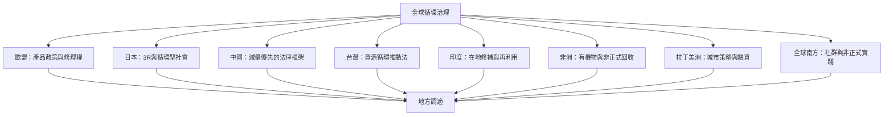

全球循環經濟有共同原則，但實踐路徑取決於資源稟賦、基礎設施、產業結構、地方知識與制度能力。跨區域比較應辨認差異而非複製單一模式。

概念脈絡：[[歐盟以產品政策把耐用、可修與可回收納入市場規則]]、[[日本把循環經濟列為循環型社會國家戰略的重要方向]]、[[中國循環經濟促進法明定減量優先並涵蓋生產流通與消費]]、[[台灣2026年修法把資源回收制度升級為資源循環推動法]]、[[印度在地修補技藝展現以技能與關係維持物品壽命的循環實踐]]、[[非洲的循環方案必須回應有機廢棄物占比與基礎設施差異]]、[[拉丁美洲循環經濟擴張需要金融工具與在地商業模式共同支持]]、[[全球南方的循環經濟更常從社群需求與非正式實踐長出來]]

## 延伸閱讀
從圖中的物質流、制度與社會關係往返閱讀，可將此地圖與各案例筆記互相修正。
