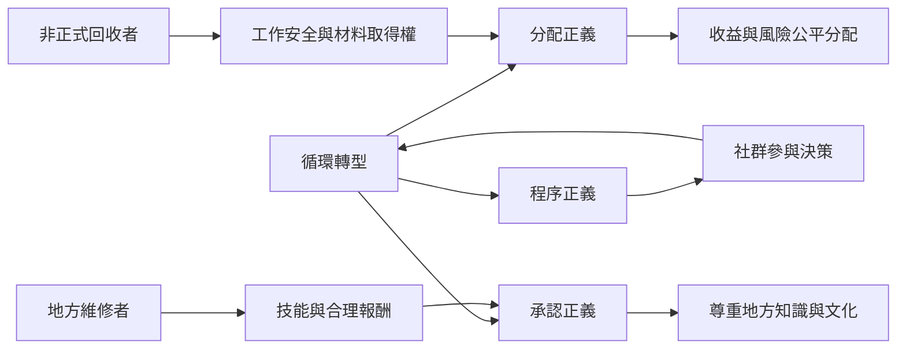

循環轉型的成本與利益不會自動公平分配。地圖從非正式勞動、維修技能、原住民族與地方社群出發，追問誰有權取得材料、誰參與決策，以及誰承擔設施風險。

概念脈絡：[[公正轉型]]、[[非正式回收者]]、[[循環經濟的社會公平不能被技術效率取代]]、[[非正式回收者是城市循環系統不可忽略的行動者]]、[[地方修補知識是循環經濟的公共基礎設施]]、[[循環轉型應由受影響社群共同決定]]

## 延伸閱讀
從圖中的物質流、制度與社會關係往返閱讀，可將此地圖與各案例筆記互相修正。
