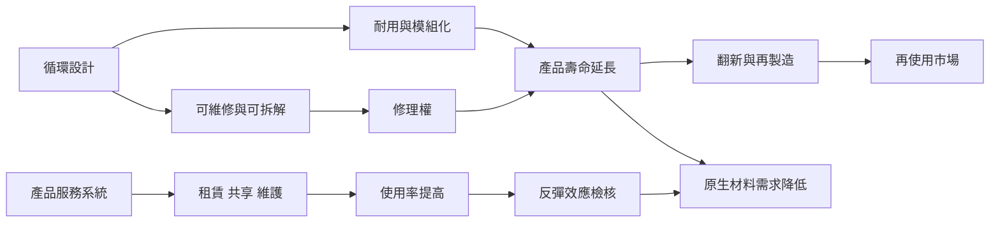

循環設計決定產品是否容易維修、拆解與再製造；商業模式則決定供應者有沒有誘因保留產品功能。共享、租賃與服務化需要進一步檢查是否真的替代新產品需求。

概念脈絡：[[修理權]]、[[產品服務系統]]、[[再製造]]、[[再使用]]、[[翻新]]、[[循環採購]]、[[修理權要有效必須同時保障零件資訊與可負擔價格]]、[[循環商業模式必須證明它真的替代了新產品需求]]

## 延伸閱讀
從圖中的物質流、制度與社會關係往返閱讀，可將此地圖與各案例筆記互相修正。
