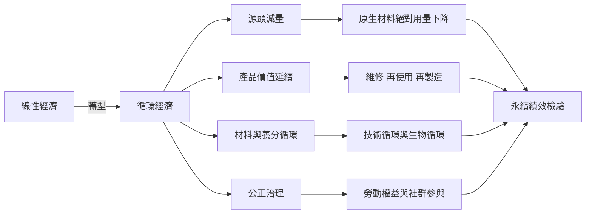

循環經濟是一套跨越產品、企業、城市與全球貿易的系統轉型。理解時先區分原生材料投入、產品功能保存、材料循環與社會治理，再檢驗實際永續結果。

概念脈絡：[[循環經濟]]、[[線性經濟]]、[[資源循環]]、[[9R策略階層]]、[[公正轉型]]、[[材料足跡]]、[[循環經濟的首要指標應包括原生材料絕對用量]]、[[循環經濟的社會公平不能被技術效率取代]]

## 延伸閱讀
從圖中的物質流、制度與社會關係往返閱讀，可將此地圖與各案例筆記互相修正。
