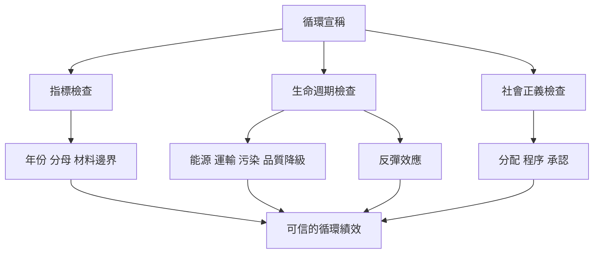

循環政策必須同時檢查指標邊界、生命週期衝擊、反彈效應、材料品質與跨境轉移。這張地圖將常見的績效誤判與治理缺口放在一起，避免循環宣稱被單一數字主導。

概念脈絡：[[循環率]]、[[生命週期評估]]、[[反彈效應]]、[[材料足跡]]、[[不平等交換]]、[[循環經濟必須避免把回收率當成唯一績效]]、[[循環率必須與消費足跡及跨境物質流一起解讀]]

## 延伸閱讀
從圖中的物質流、制度與社會關係往返閱讀，可將此地圖與各案例筆記互相修正。
