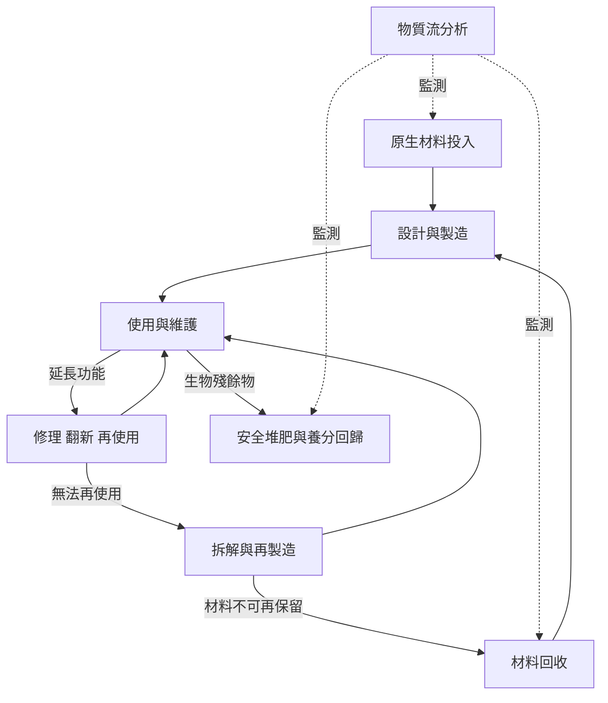

本地材料流如何轉變，必須先盤點物質流，再依資源價值保留程度選擇策略。預防、減量與產品功能保存通常優先於末端回收；指標須同時呈現流量、存量、品質與去向。

概念脈絡：[[物質流分析]]、[[材料足跡]]、[[循環率]]、[[循環缺口]]、[[9R策略階層]]、[[廢棄物階層]]、[[材料護照]]、[[全球循環率下降顯示回收進步追不上物質消耗成長]]

## 延伸閱讀
從圖中的物質流、制度與社會關係往返閱讀，可將此地圖與各案例筆記互相修正。
