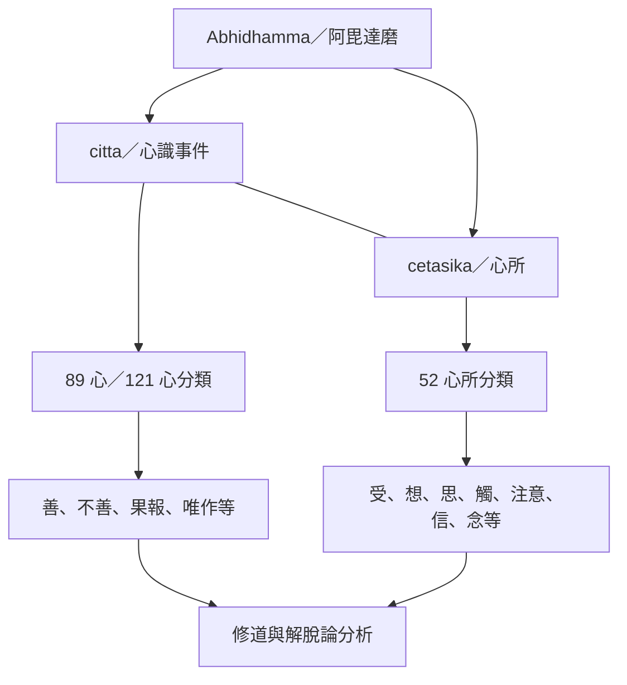

上座部阿毘達磨將心識事件與伴隨的心理因素分層描述。`citta` 指心識事件，`cetasika` 指共同生起的心所；其 89／121 心與 52 心所的分類，屬於特定宗派的論書系統。

先閱讀[[上座部阿毘達磨把citta分類為八十九或一百二十一種]]，再閱讀[[上座部阿毘達磨以五十二心所說明心識事件的構成]]。這些分類不等於現代腦科學分類，參見[[阿毘達磨的心識分類是一種解脫論模型而非腦科學分類]]。

## 參考
* [[心所與心識應以互依關係理解而非主體與附件理解]]
* [[citta是一個動態心態過程而不是固定實體]]
