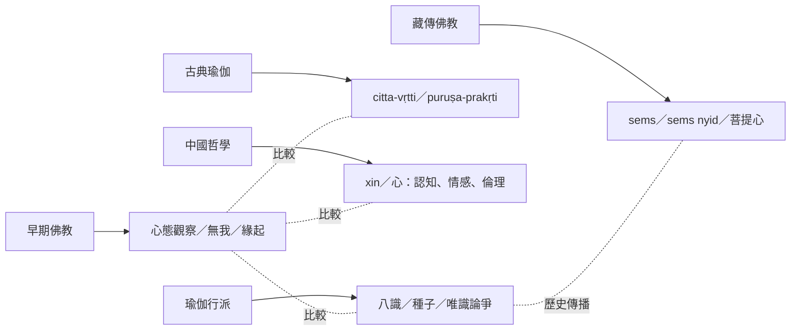

這張地圖把幾種不同問題意識的心論並列：早期佛教如何觀察心態並避免自我執取；瑜伽行派如何說明認知、種子與相續；古典瑜伽如何區分心的活動與見者；中國哲學如何以「心」統合認知、情感和倫理判斷。比較的目的不是得出一個共同答案，而是讓差異變得清楚。

各自閱讀：[[早期佛教以心的狀態與作用討論citta而非建立單一心靈實體]]、[[瑜伽行派以阿賴耶識說明習氣種子與心識相續]]、[[瑜伽經以止息心的活動界定瑜伽但不等同佛教觀心]]、[[中國哲學的心是兼具認知情感意向與倫理判斷的心靈]]、[[藏語sems保留了心智情感與意向的整體面向]]。

## 參考
* [[跨傳統比較心必須區分詞彙相似與理論相同]]
* [[為跨文化心智研究建立保留原語的語義地圖]]
