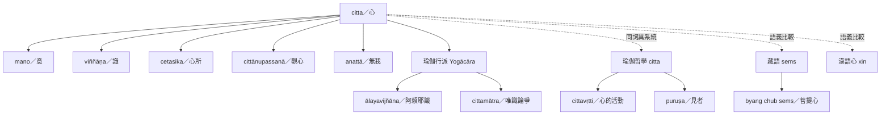

`Citta` 是一個跨越巴利語、梵語、藏語與漢譯佛典的關鍵詞，但相同詞形不保證理論相同。此圖先呈現佛教內部術語，再把印度瑜伽、藏傳及中國心論放在比較層，而不把它們合併成一個心靈模型。

閱讀時先掌握[[citta｜心]]、[[mano｜意]]、[[viññāṇa｜識]]與[[cetasika｜心所]]的基本差異；再讀[[Ālayavijñāna｜阿賴耶識]]與[[Cittamātra｜唯識／唯心]]；最後比較[[Cittavṛtti｜心的活動／變動]]、[[Puruṣa｜神我／見者]]、[[Sems｜藏語的心]]與[[Xin｜心]]。

## 參考
* [[跨傳統比較心必須區分詞彙相似與理論相同]]
* [[經典中的citta mano與viññāṇa須依語境理解]]
