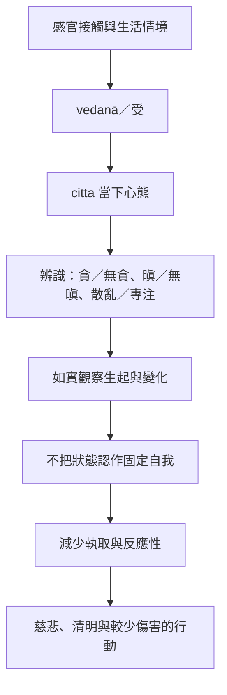

早期佛教的觀心路徑由辨識狀態開始，逐步看見心與感受、接觸、習慣及行為的關係。觀心並不取代身、受、法的觀察，也不是尋找一個不變的內在觀察者。

核心概念：[[Satipaṭṭhāna｜四念處]]、[[cittānupassanā｜觀心]]、[[Vedanā｜受]]、[[Mettā｜慈心]]、[[anattā｜無我]]。經典與研究請參閱[[念住經把觀心化為辨識當下心態的訓練]]、[[法句經第三品以調直箭桿比喻馴心與護心]]、[[增支部一四九至五二以客塵煩惱說明心的明淨]]。

## 參考
* [[觀心的第一步是辨識狀態而非壓制念頭]]
* [[每日以四個問題記錄心的狀態與條件]]
