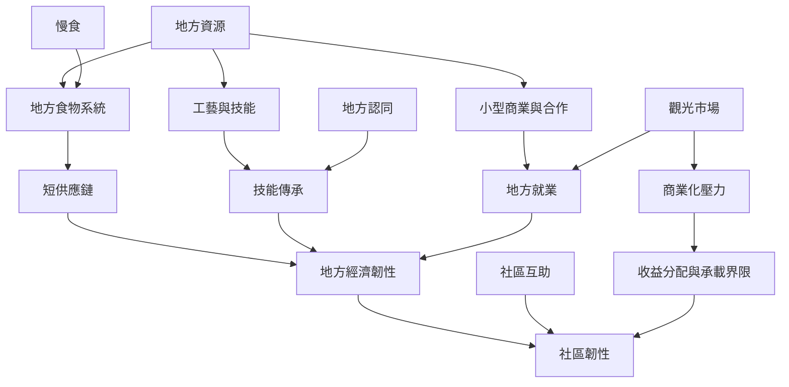

本圖呈現地方生產、技能傳承、食物系統與社區韌性之間的關係。慢城的地方經濟不只是觀光收入，也包括地方如何維持日常供應、創造工作、共享知識並面對人口與環境變化。

* [[慢食]]、[[地方食物系統]]、[[內生發展]]、[[社區韌性]]、[[地方認同]]、[[生態美食]]。
* [[地方經濟韌性建立於在地供應鏈和技能傳承]]。
* [[由慢食到慢城：食物系統成為地方治理入口]]。
* [[韓國清山島透過慢城策略回應人口流失與偏鄉韌性問題]]。
* [[慢生活理論把地方性時間倫理與食物政治連在一起]]。
* [[觀光能創造收入也可能侵蝕居住空間與文化]]。
