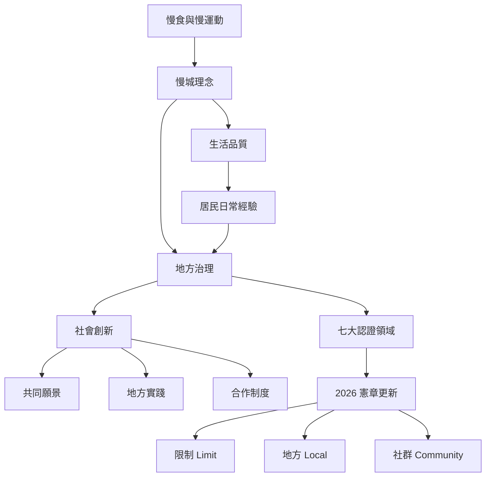

本圖從慢食與慢運動的思想源流，連到生活品質、七大認證領域與 2026 年新版憲章，再以社會創新與地方治理理解政策如何落地。閱讀時可把制度當成持續修正的學習框架，而不是一次取得的標章。

* [[慢城]]、[[慢運動]]、[[慢食]]、[[生活品質]]、[[社會創新]]、[[地方治理]]、[[社區賦權]]。
* [[慢城運動從慢食理念延伸為地方治理實驗]]。
* [[慢城認證將七大政策領域轉成地方品質指標]]。
* [[2026年憲章以限制地方社群重申慢城21世紀方向]]。
* [[慢城不是速度更慢而是重新分配地方發展的優先次序]]。
* [[認證指標能把理念變成政策也會讓地方迎合評鑑]]。
* [[社會創新需要語義實踐與制度三層彼此支撐]]。
