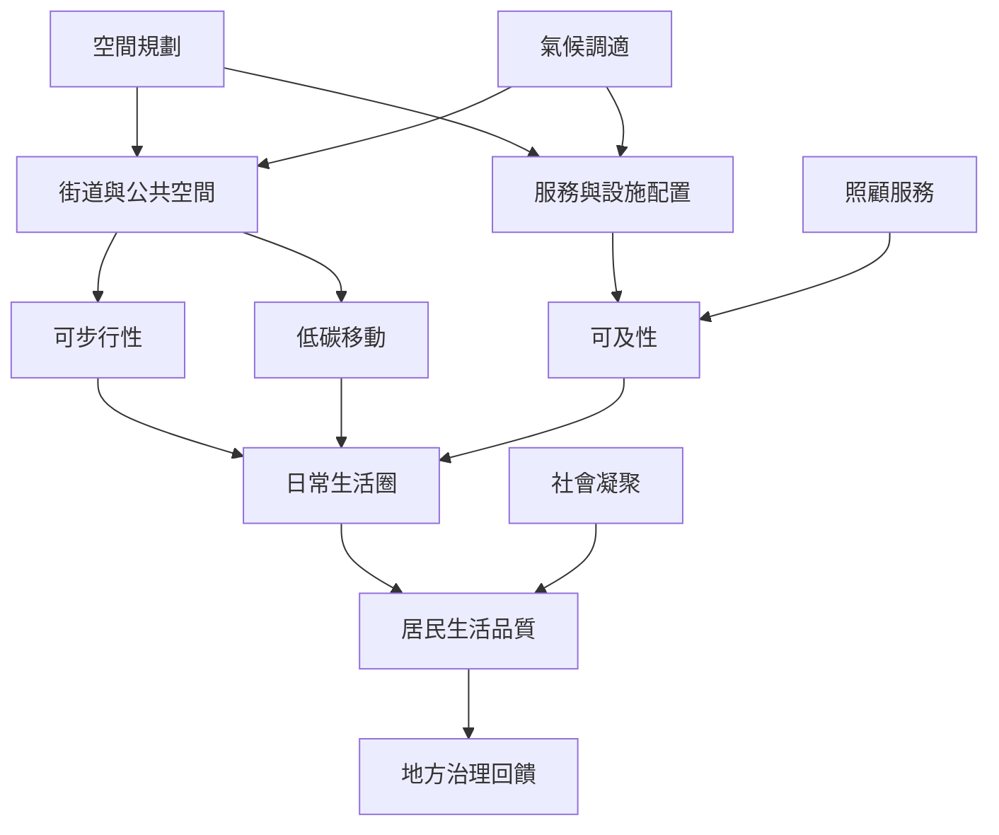

本圖把空間尺度、移動、可及性、氣候調適與居民生活品質連成一條治理鏈。慢城若要落實到身體經驗，需要在道路、公共交通、綠地、服務位置與照顧設施上做出實際改變。

* [[可步行性]]、[[可及性]]、[[低碳移動]]、[[十五分鐘城市]]、[[氣候調適]]、[[生活品質]]。
* [[慢城交通設計應以可及性健康與步行騎行為城市目標]]。
* [[波蘭慢城空間規劃研究分析三十六座城鎮]]。
* [[在台中潭子建立居民主導的慢生活觀察簿]]。
* [[以步行稽核繪出十五分鐘日常生活圈的真實邊界]]。
* [[把幼兒長者與身障者的照顧可近性納入慢城盤點]]。
