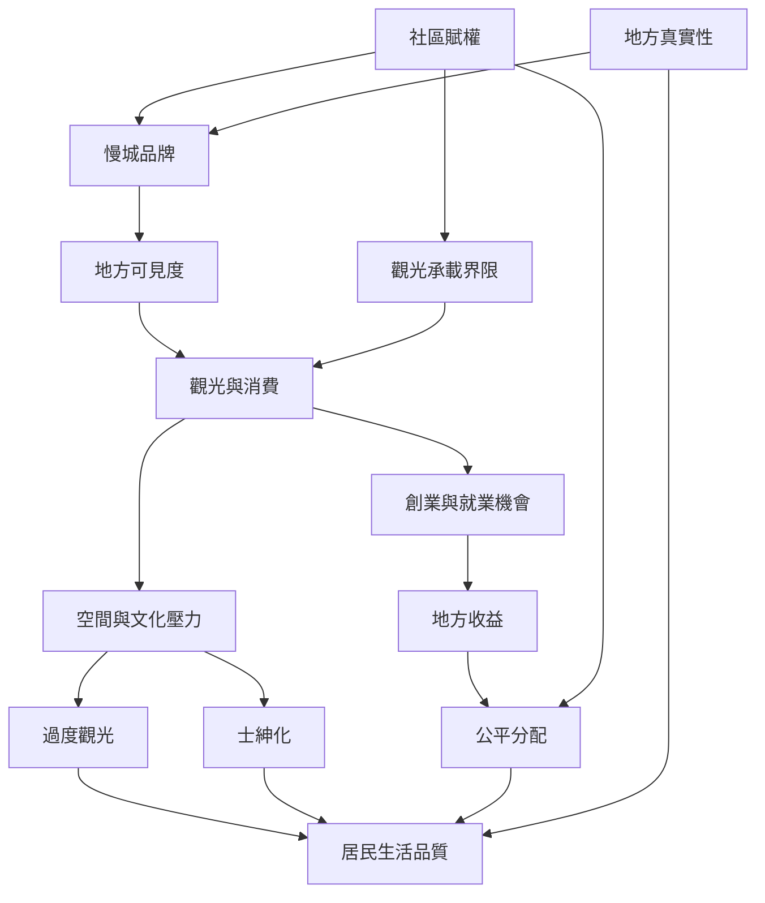

本圖整理慢城品牌、地方認同、觀光收益與居民生活之間的複雜關係。地方特色的可見度可能增加創業機會，也可能帶來商品化、租金壓力及公共空間排擠；核心問題是居民是否擁有界定地方形象、設定承載界限及分享收益的權力。

* [[地方認同]]、[[地方真實性]]、[[永續觀光]]、[[慢旅遊]]、[[過度觀光]]、[[士紳化]]、[[觀光承載量]]、[[社區賦權]]。
* [[慢食與慢城的生態美食遺產會同時帶來地方發展與商業化風險]]。
* [[土耳其762名居民資料顯示慢城認證與地方真實性和經濟機會相關]]。
* [[Goolwa以社區參與和賦權推動歐洲外慢城實踐]]。
* [[設計慢旅遊時先約定居民優先與觀光承載界限]]。
* [[以居民小型議會共同決定地方慢生活優先事項]]。
