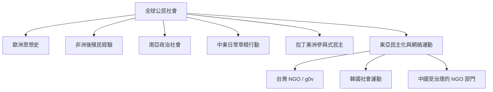

跨區域比較公民社會，應同時觀察國家形成、殖民歷史、民主化路徑、宗教與地方社群、正式組織、非正式政治及科技環境。區域不是同質單位，以下個案只是進入文獻的入口，而非代表整個區域。

## 關係圖

## 延伸閱讀
* [[台灣 NGO 與民主化在 1980 年代後形成互相推動的關係]]
* [[台灣 g0v 社群呈現公民科技如何成為 NGO 人才與行動的入口]]
* [[韓國民主化後的公民社會從群眾運動走向議題分化與網絡化]]
* [[中國 NGO 的成長顯示威權國家也會選擇性擴大公民組織空間]]
* [[印度後殖民研究以政治社會補充西方公民社會模型]]
* [[非洲的雙重公共領域理論提醒我們殖民歷史會重塑國家社會關係]]
* [[中東草根行動可透過日常生存實踐形成公共政治]]
* [[巴西阿雷格里港參與式預算展示公民社會與國家共同治理的可能]]
* [[公民社會概念必須接受在地歷史的檢驗]]、[[政治社會]]、[[跨國倡議網絡]]。
