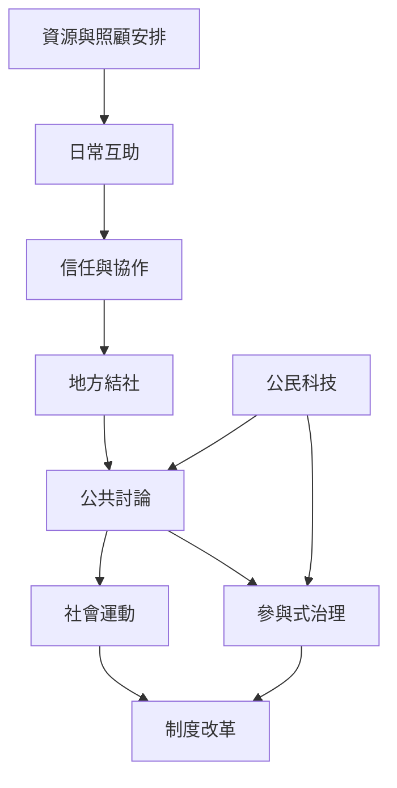

公民社會的日常實踐包含自願結社、互助、公共討論、社會運動、公共預算參與與公民科技。各種實踐需要不同技能與資源，也會互相轉換：地方共餐可能發展出互助網絡，互助網絡可能形成倡議，倡議可能進入政策程序。

## 關係圖

## 延伸閱讀
* [[低門檻參與能把公民興趣轉化為持續行動]]
* [[自願結社讓民主能力在日常生活中被練習]]
* [[互助與日常實踐能累積公民行動的能力]]
* [[參與式治理要從諮詢走向共同決策]]
* [[公民科技必須連接社群關係與制度回應]]
* [[用一張地方公民生態地圖看見正式組織之外的公共生活]]
* [[把共餐讀書會設計成低門檻的民主練習場]]
* [[建立由一次參與到長期倡議的公民技能階梯]]
* [[互助]]、[[社會運動]]、[[參與式預算]]、[[公民科技]]、[[共同化]]。
