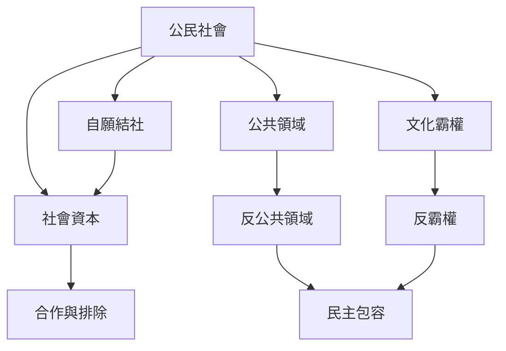

公民社會的思想史可以從自願結社、國家與社會的區分、文化霸權、公共領域與社會資本等脈絡理解。不同理論不是同一個定義的不同說法，而是在回答不同問題：人們如何組織？公共意見如何形成？社會如何同意或抵抗權力？信任與網絡如何影響制度？

## 關係圖

## 延伸閱讀
* [[自願結社讓民主能力在日常生活中被練習]]
* [[民主公共領域必須讓受影響者參與議題設定]]
* [[弱勢群體需要自己的反公共領域才能形成政治語言]]
* [[公民社會是民主權利與公共自主的爭議場域]]
* [[托克維爾把自願結社視為民主社會的基本能力]]
* [[葛蘭西指出公民社會也是文化霸權形成與抵抗的陣地]]
* [[哈伯瑪斯以公共領域說明社會如何把溝通轉化為政治力量]]
* [[傅瑞瑟以反公共領域揭示公共討論中的不平等]]
* [[普特南以義大利區域治理研究社會資本與制度績效]]
* [[公民社會]]、[[公共領域]]、[[反公共領域]]、[[文化霸權]]、[[社會資本]]、[[結社主義]]。
