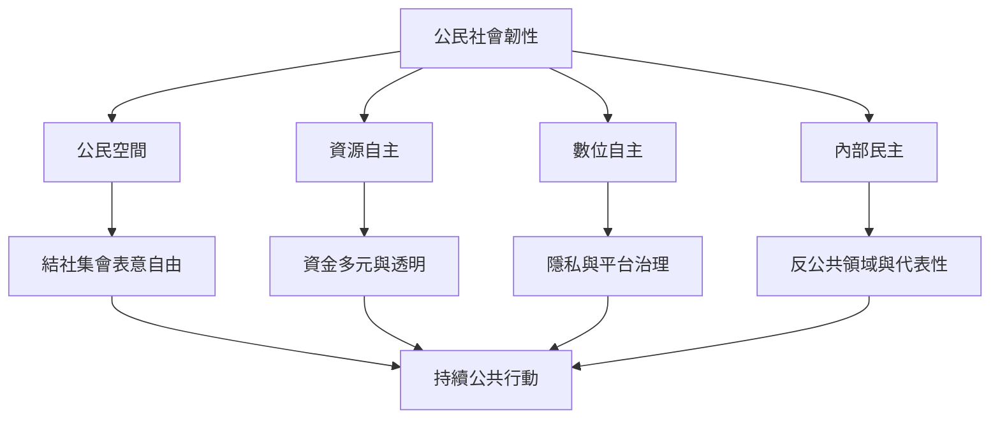

當代公民社會面對公民空間縮窄、法律與行政限制、資金不穩、數位監控、平台權力、民主倒退及內部代表性不足等交疊挑戰。回應不應只有組織存活，也要同時維護自主、公共問責、在地知識與跨群體合作。

## 關係圖

## 延伸閱讀
* [[民主倒退時公民社會也會成為權力競爭的目標]]
* [[CIVICUS 以結社集會表意自由衡量各國公民空間]]
* [[聯合國 2026 年報告將公民空間視為和平社會的基礎設施]]
* [[CIVICUS 2026 年報告記錄全球公民行動與民主抵抗]]
* [[2026 年公民社會資金調查揭示資源縮減會侵蝕組織自主]]
* [[公民空間受到法律限制時也需要追蹤行政與數位壓迫]]
* [[社會資本能連結群體也可能鞏固排除]]
* [[以公民空間觀察清單追蹤地方自由是否正在縮窄]]
* [[公民空間]]、[[資源自主]]、[[數位民主]]、[[問責]]、[[交織性]]。
