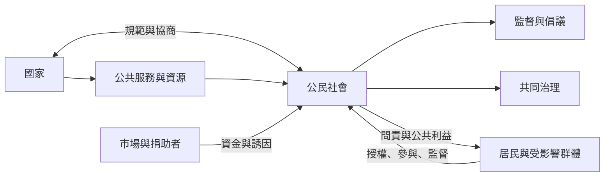

公民社會與國家之間不是簡單的對立。公民組織可以監督、倡議、共同治理或提供服務；國家也可能支持、規範、吸納或壓制組織。分析重點在於誰能設定議題、分配資源、保留批評權與決定退出合作。

## 關係圖

## 延伸閱讀
* [[殖民治理遺緒會形塑公民身份與公共責任]]
* [[資金多元化必須同時保護組織的公共問責]]
* [[公民社會的韌性來自多層次且可轉換的網絡]]
* [[公民社會與國家不是只能二選一]]
* [[中國 NGO 的成長顯示威權國家也會選擇性擴大公民組織空間]]
* [[巴西阿雷格里港參與式預算展示公民社會與國家共同治理的可能]]
* [[組織數量增加不代表公民自主性提高]]
* [[公民社會需要在地自主且可持續的資源]]
* [[公民社會]]、[[公民社會組織]]、[[政治社會]]、[[公民空間]]、[[參與式治理]]。
