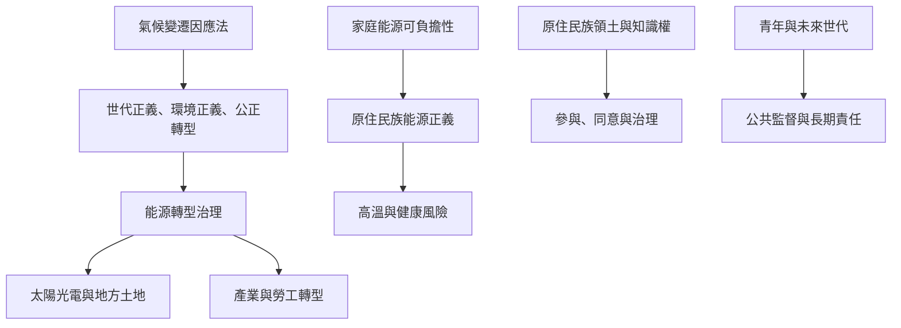

台灣的氣候正義可從法律承諾、能源開發、家庭能源服務、原住民族權利、勞動轉型與世代參與六個入口觀察。分析時應同時看國家尺度的減碳與供電目標，以及地方尺度的土地、健康、能源可負擔性與文化治理。

核心連結：[[台灣能源轉型需要同時考慮全國減碳與地方正義]]、[[法律承認正義原則仍需要預算程序與問責機制]]、[[自由事先知情同意]]、[[能源貧窮]]。

資料入口：[[台灣氣候變遷因應法將世代正義環境正義與公正轉型納入法律目的]]、[[台灣太陽光電案例顯示能源轉型可能同時產生綠色對人與綠色對自然衝突]]、[[台灣原住民族能源正義調查指出夏季電費負擔與能源貧窮問題]]。
