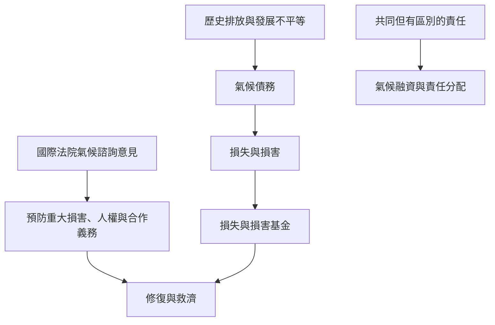

國際氣候治理不只是設定減排目標，也涉及各國歷史責任、發展需求、資金能力及對已發生損害的修復。共同但有區別的責任提供責任分配原則；氣候債務與損失與損害則將歷史排放與現實受害連結；國際法院諮詢意見進一步澄清國際法下的國家義務。

核心連結：[[氣候債務]]、[[共同但有區別的責任]]、[[損失與損害]]、[[修復正義]]、[[氣候訴訟]]。

資料入口：[[損失與損害基金的首輪需求顯示脆弱國家仍面臨巨大的資金落差]]、[[國際法院氣候變遷諮詢意見將氣候義務連結環境保護與人權]]、[[氣候債務研究透過跨國社運訪談連結公共債務與氣候修復]]。
