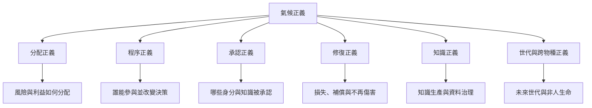

氣候正義是一套檢查氣候危機與氣候行動如何再製或改變不平等的視角。入門可先從 IPCC 的分配、程序與承認三原則開始，再依案例延伸至修復、知識、代表、能力、世代與跨物種正義。

核心連結：[[氣候正義]]、[[分配正義]]、[[程序正義]]、[[承認正義]]、[[修復正義]]、[[知識正義]]、[[世代正義]]、[[能力取徑]]。

資料入口：[[IPCC氣候正義三原則將負擔分配決策參與與文化承認並列]]、[[氣候正義的九領域分類將知識代表能力與結構轉型納入政策檢查]]。
