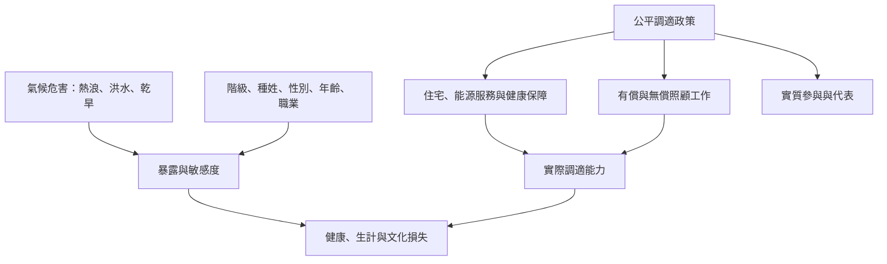

氣候調適的成果由社會條件中介。性別、種姓、收入、職業、年齡與住宅條件決定人們面對同一氣候危害時能否避險。照顧工作支撐社會的日常調適，卻常被政策忽視。交織性分析可以避免把脆弱群體當作同質類別。

核心連結：[[交織性]]、[[氣候調適]]、[[能源貧窮]]、[[照顧經濟]]、[[能力取徑]]、[[不當調適]]。

資料入口：[[印度熱浪研究顯示種姓階序會改變勞動者的熱暴露程度]]、[[UN Women性別氣候政策評分卡要求辨識照顧工作與女性參與落差]]、[[台灣原住民族能源正義調查指出夏季電費負擔與能源貧窮問題]]。
