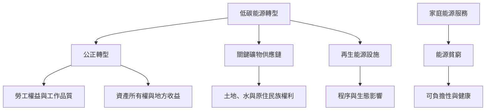

能源轉型的公平性取決於能源系統如何生產、持有、定價和治理。從煤炭退場到再生能源建置，再到鋰、鎳等關鍵礦物供應鏈，每個環節都可能產生新的分配與承認問題。公正轉型需要處理就業、資產所有權、地方收益與歷史污染，而能源正義也必須包括家庭能否負擔能源服務。

核心連結：[[公正轉型]]、[[能源正義]]、[[能源貧窮]]、[[氣候殖民性]]、[[領土主權]]。

資料入口：[[南非煤炭社區研究指出公正能源轉型牽涉地方所有權與勞工權力]]、[[玻利維亞鋰礦民族誌揭示綠色轉型可能壓縮地方社會的未來想像]]、[[台灣太陽光電案例顯示能源轉型可能同時產生綠色對人與綠色對自然衝突]]。
