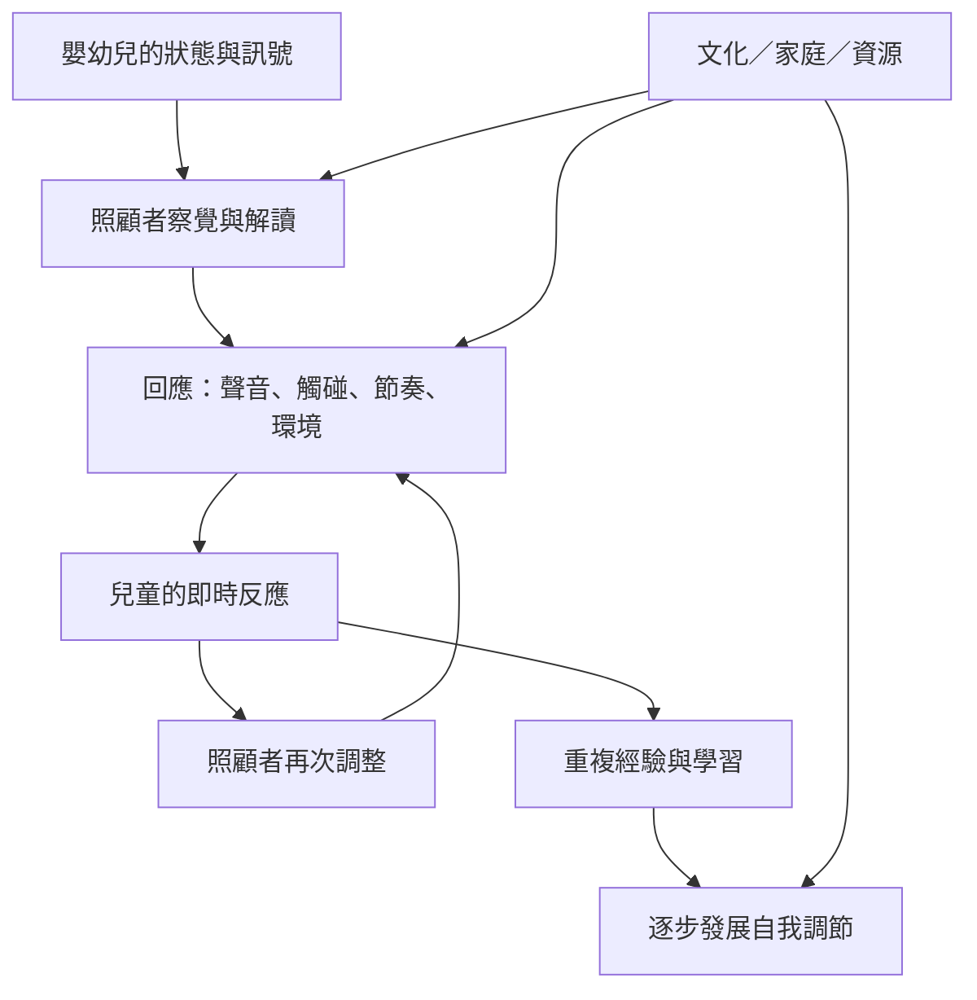

發展觀點將自我調節理解為在照顧者與環境支持下逐步形成的能力。這不是一條單向、線性的內化路徑，而是隨年齡、任務、文化與關係變化的動態歷程。

概念連結：[[自我調節]]、[[發展支架]]、[[依附]]、[[情緒社會化]]、[[共同照顧]]。

依據：[[親子互動的靈活與情感回應性與兒童自我調節相關]]、[[家庭共同調節必須放進整個家庭系統理解]]、[[烏干達與英國母嬰研究顯示回應速度不等於安撫成效]]。
