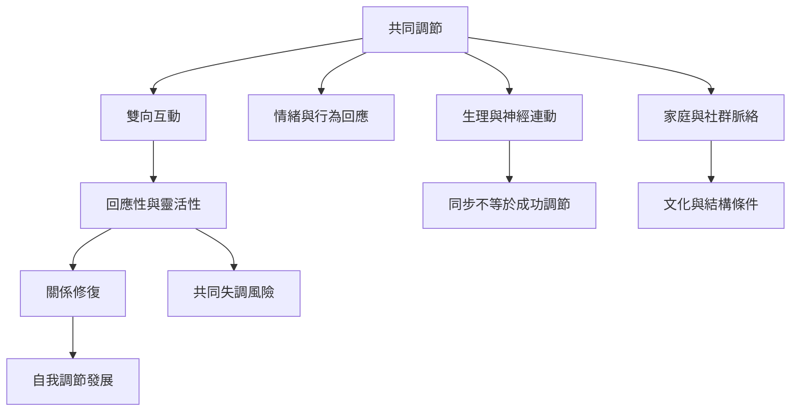

共同調節研究交會於發展心理學、人際情緒調節、家庭系統、社會神經科學與文化心理學。概念核心是互動者相互影響與持續調整；分析時要同時看見雙方能動性、關係品質、互動情境與制度條件。

概念連結：[[共同調節]]、[[人際情緒調節]]、[[自我調節]]、[[共同失調]]、[[互動同步]]、[[文化心理學]]、[[社會支持]]。

依據：[[共同調節是關係雙方持續相互調整的動態歷程]]、[[共同調節包含生理行為與關係脈絡的多層次互動]]、[[證據導向的共同調節實踐應避免單一理論包辦解釋]]。
