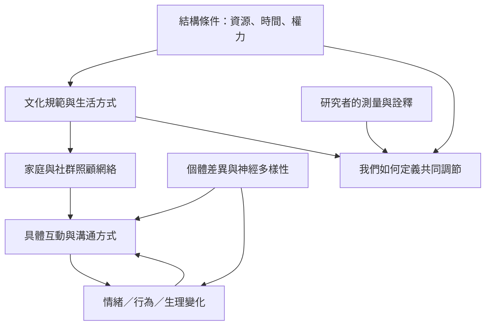

共同調節的發生與意義，受到身體、互動、關係、家庭、社群、文化與制度環境共同形塑。跨文化研究顯示，照顧回應的速度與形式可能不同，卻未必代表照顧品質高低。

概念連結：[[文化相對性]]、[[文化心理學]]、[[共同照顧]]、[[神經多樣性]]、[[社會支持]]、[[結構性條件]]。

依據：[[文化會透過個人關係與制度條件共同調節情緒]]、[[納米比亞與喀麥隆的 !Xun 和 Baka 研究呈現多位照顧者共同參與]]、[[教師的共同調節取決於如何同時注意情緒行為與學習]]。
