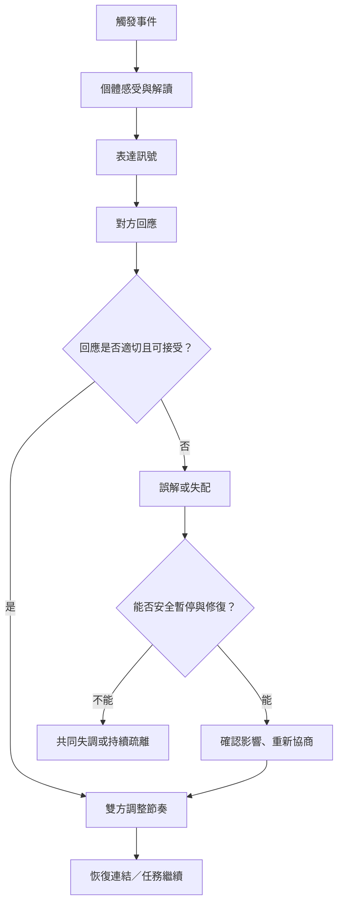

共同調節不是永遠平穩的互動，而是訊號、回應、重新評估與修復的循環；失配可能成為學習契機，也可能在缺乏安全與資源時逐步升高。

概念連結：[[共同調節]]、[[共同失調]]、[[情緒升高循環]]、[[關係修復]]、[[同意]]、[[界線]]。

依據：[[早期共同調節應被理解為動態系統中的同步與失調]]、[[親密伴侶情緒調節具有雙向動態與正負兩面效果]]、[[有效共同調節需要界線同意與修復能力]]。
