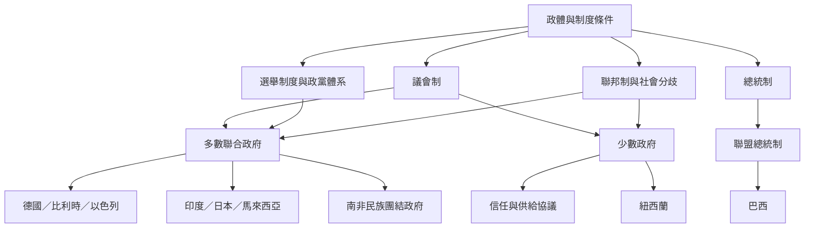

聯合政府不是單一制度模型。議會制多數聯盟、少數政府、信任供給、民族團結政府及總統制聯盟，分別受到政體、選舉制度、聯邦結構與社會分歧影響。比較時應先釐清案例分類，再討論政策與耐久性。

延伸閱讀：[[總統制聯盟不能直接套用議會制模型]]、[[聯邦制讓地域政黨成為中央組閣的關鍵行動者]]、[[多元社會的聯合政府必須處理認同與地域的交錯分歧]]、[[比較聯合政府需要把內閣組成連結到議會支持資料]]。

本圖與[[聯盟形成與組閣談判概念地圖]]互相連結。

本篇隸屬於[[Coalition_government]]專題。
