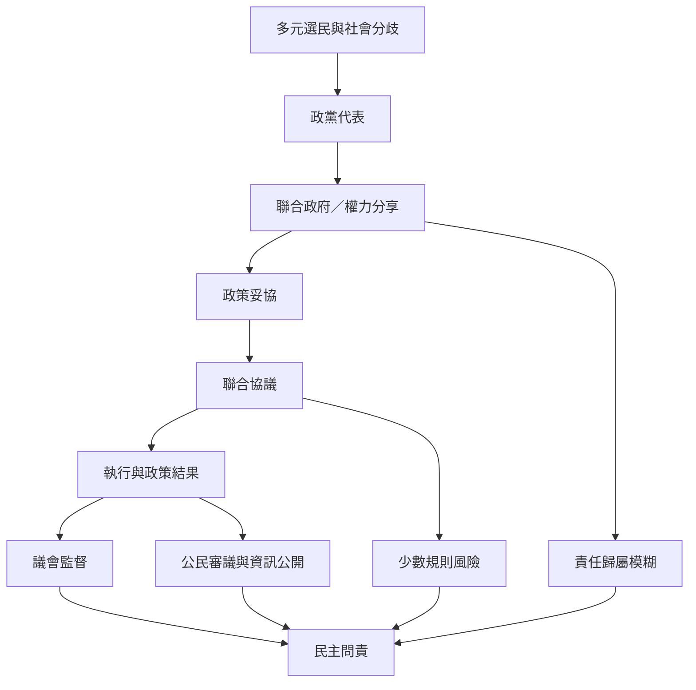

聯合政府的民主價值在於權力分享與多元代表；其風險則包括責任模糊、協議封閉、跨議題交易與少數規則。判斷民主品質需要同時考察代表性、程序透明、政策效果與基本權利。

延伸閱讀：[[聯合政府能擴大代表性但不保證政策共識]]、[[聯合協議既能協調政策也可能阻斷多數意見]]、[[聯盟耐久性不能取代治理品質的評估]]、[[用公民審議補足政黨聯盟協議的代表性缺口]]。

本圖與[[聯合政府治理與政策執行概念地圖]]互相連結。

本篇隸屬於[[Coalition_government]]專題。
