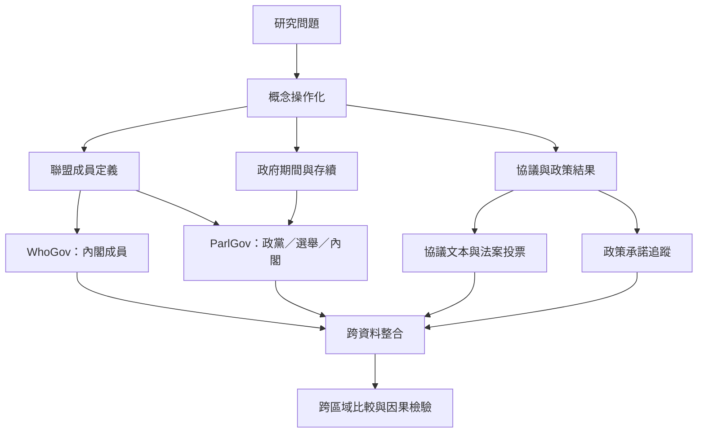

比較研究需把理論概念轉成可觀察資料，並將政府成員、政黨席次、協議、議會投票與政策成果連結。不同資料庫涵蓋範圍與單位不同，交叉使用時必須保存版本與編碼原則。

延伸閱讀：[[全球內閣成員資料可用WhoGov比較政治菁英]]、[[ParlGov可用來重建成熟民主國家的選舉與內閣序列]]、[[比較聯合政府需要把內閣組成連結到議會支持資料]]。

本圖與[[制度類型與跨區域案例概念地圖]]互相連結。

本篇隸屬於[[Coalition_government]]專題。
