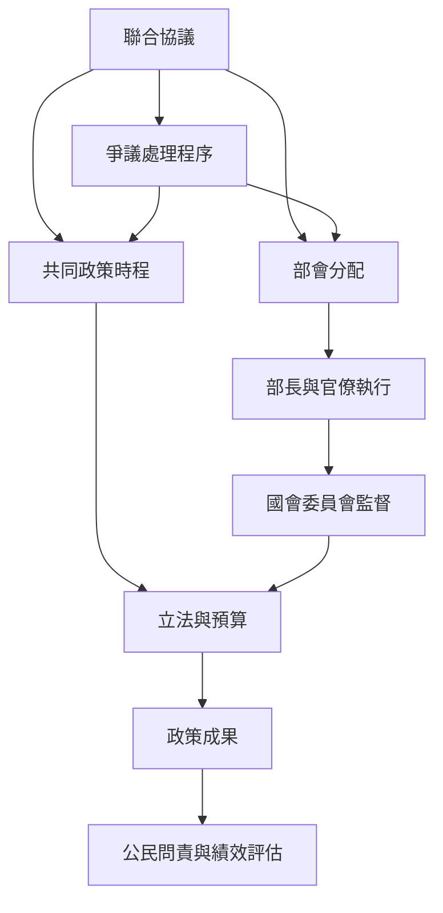

組閣完成後，聯盟需要把協議轉化為行政決策與立法成果。部會分配、部長自主性、國會委員會、協議執行與衝突管理共同構成治理架構。

延伸閱讀：[[部會分配同時是資源分享與政策控制]]、[[強勢國會制度能降低聯合政府的代理與背約風險]]、[[聯合政府的治理能力來自制度化衝突管理]]、[[民主問責需要追蹤協議承諾的執行情況]]。

本圖與[[聯盟形成與組閣談判概念地圖]]、[[民主代表性與問責概念地圖]]互相連結。

本篇隸屬於[[Coalition_government]]專題。
