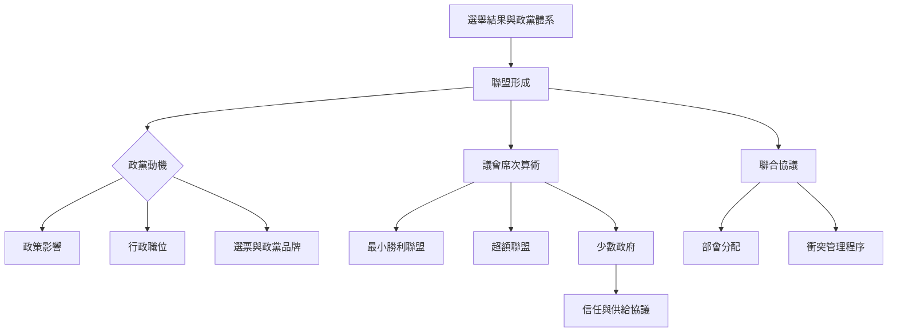

聯盟形成的核心問題，是政黨如何將選舉結果轉換成可取得信任、能組成內閣或維持外部議會支持的安排。關鍵變項包括政黨動機、席次算術、選制、社會分歧、協議內容與談判成本。

延伸閱讀：[[聯合政府把選舉後的席次轉化為共同執政安排]]、[[政黨組閣同時追求政策職位與選票]]、[[最小勝利聯盟是理論基準而非普遍規律]]、[[少數政府可以依靠外部協議而穩定執政]]、[[組閣談判時間可能是政策協調的投資]]。

本圖與[[聯合政府治理與政策執行概念地圖]]、[[制度類型與跨區域案例概念地圖]]互相連結。

本篇隸屬於[[Coalition_government]]專題。
