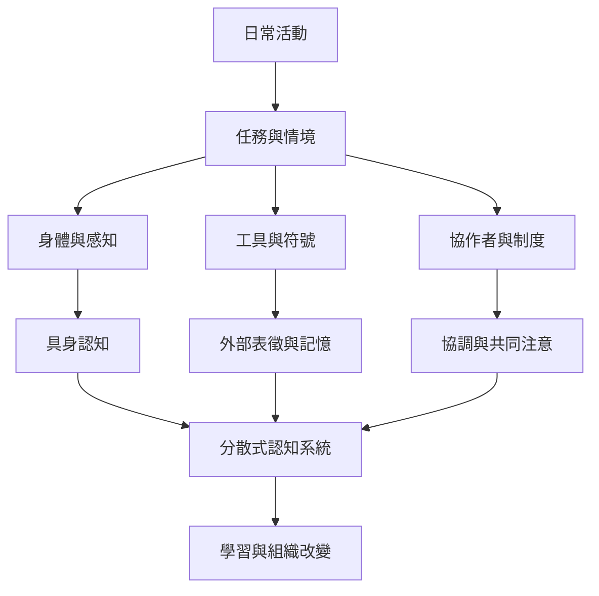

分散式與情境取徑把認知從個體內部擴展到活動系統。研究者觀察人、工具、符號、空間與制度如何協作，使記憶、計算、學習與決策得以完成。這條路徑能連接知識工作、日常生活、技藝傳承與數位工具研究。

代表研究是[[../data/日常算術須放回實際情境才能被理解]]與[[../data/導航團隊與工具共同構成分散式認知系統]]；可延伸至[[../idea/把共食活動視為知識如何在人與物之間流動的田野]]和[[../idea/把數位知識庫當成協作記憶系統而非個人收藏]]。概念入口為[[../term/分散式認知]]、[[../term/情境認知]]、[[../term/具身認知]]與[[../term/認知民族誌]]。
