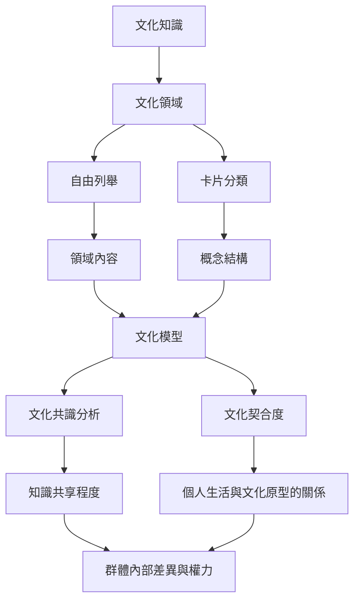

文化模型研究關注知識如何成為日常理解框架，以及它如何在個人之間分布。文化領域分析可找出概念範圍，文化共識分析可估計共享模式，而文化契合度則觀察個體生活與群體原型的接近程度。這些方法應與民族誌和權力分析結合。

相關研究見[[../data/文化模型透過語言與日常理解組織知識]]、[[../data/文化共識分析可以估計共享知識及個人知識差異]]、[[../data/都市巴西的文化模型與生活契合度和心理困擾相關]]。概念可參考[[../term/文化領域分析]]、[[../term/文化模型]]、[[../term/文化共識分析]]與[[../term/文化契合度]]。
