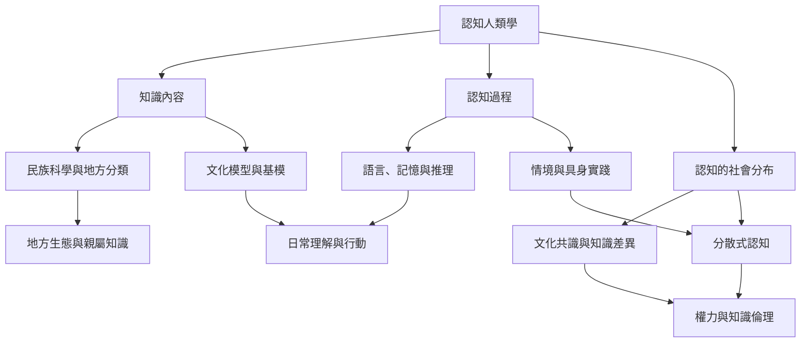

認知人類學的核心問題，是理解人們如何在文化脈絡中形成知識、分類世界、記憶、推理並行動。研究可以從語義與地方分類出發，延伸至文化模型、語言與思想、日常實踐、分散式認知，再回到權力、倫理與知識傳承。

主要分支可由[[../note/認知是身心環境與社會實踐共同生成的能力]]、[[../note/共享知識是分布不均的而不是人人持有同一套文化]]、[[../note/分類系統不只命名事物也組織社會關係與行動]]進入；概念基礎見[[../term/認知人類學]]、[[../term/民族科學]]、[[../term/文化模型]]與[[../term/分散式認知]]。
