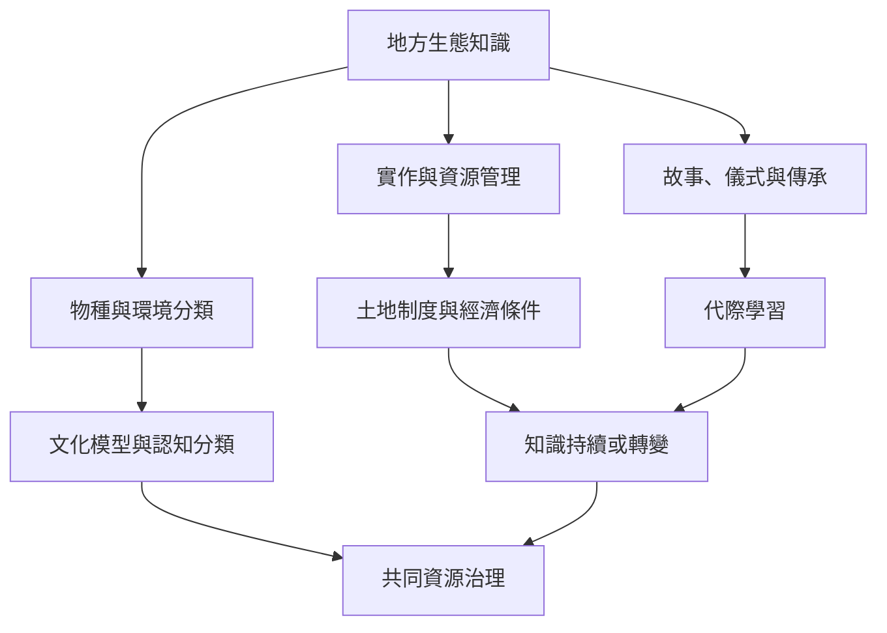

地方生態知識將認知研究帶到物種分類、土地使用、資源管理、社會網絡與代際傳承。認知模式不是獨立於環境的觀念集合：知識能否持續存在，與人們是否能接觸土地、參與實作以及維持社群制度密切相關。

可由[[../data/瑪雅地方生態知識與共同資源治理互相構成]]、[[../data/Itza’ Maya森林知識會隨代際與經濟環境改變]]進入，並延伸至[[../idea/為地方知識建立可撤回且由社群治理的開放檔案]]。概念入口為[[../term/地方生態知識]]、[[../term/民族生物學]]、[[../term/文化傳遞]]和[[../term/原住民族研究方法]]。
