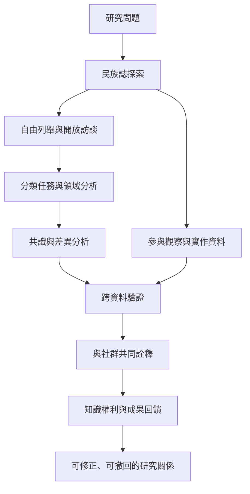

認知人類學的方法必須在「可比較」與「忠於地方脈絡」之間取得平衡。訪談、自由列舉、分類任務與共識分析可以建立可檢驗資料，但研究者也要交代工具如何塑造答案、誰被納入、哪些知識不宜公開，以及分類權由誰掌握。

方法案例見[[../data/文化領域分析以自由列舉與分類任務描繪共享知識]]；倫理視角見[[../data/原住民族研究方法必須從社群自己的知識傳統出發]]。可用概念包括[[../term/民族誌訪談]]、[[../term/文化領域分析]]、[[../term/文化共識分析]]、[[../term/原住民族研究方法]]與[[../term/知識正義]]。
