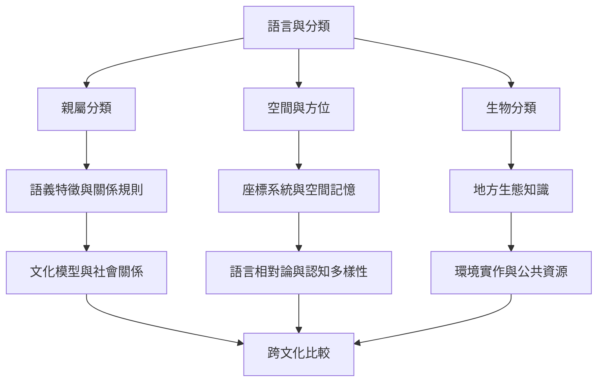

語言和分類是認知人類學的經典切入點。研究者透過親屬稱謂、方位詞、顏色詞與地方生物分類，分析語言形式如何連結概念系統、注意與記憶。跨文化比較需要同時辨識普遍認知能力與地方形成的認知策略。

經典材料包括[[../data/親屬稱謂的語義分析能重建地方性的關係分類規則]]、[[../data/語言中的絕對方位詞會改變空間記憶與定位策略]]與[[../data/瑪雅地方生態知識與共同資源治理互相構成]]。概念入口為[[../term/語義成分分析]]、[[../term/語言相對論]]、[[../term/民族生物學]]及[[../term/認知多樣性]]。
