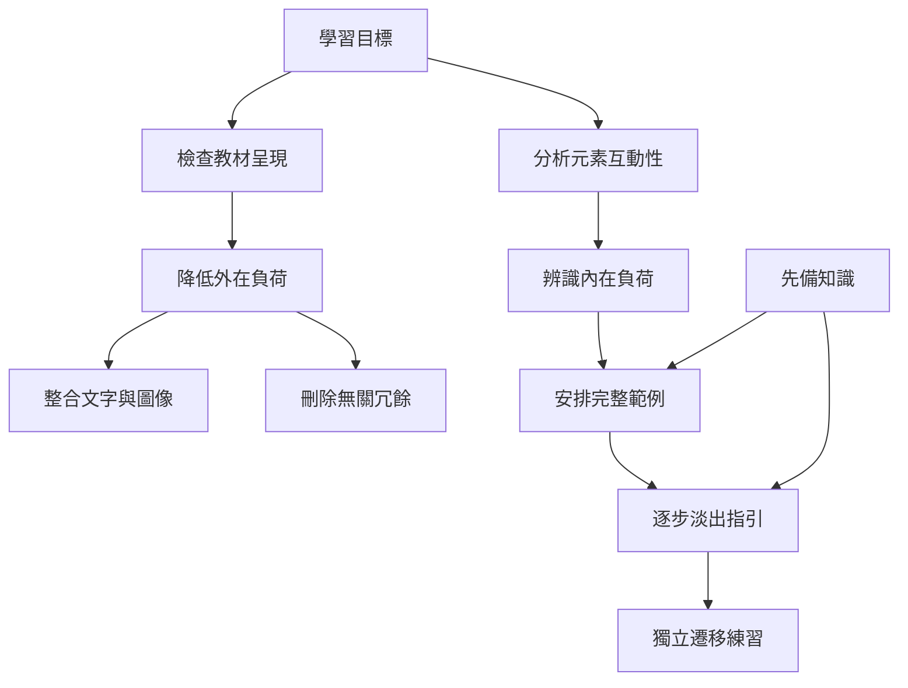

教學設計的目標是移除不必要的搜尋與整合成本，同時保留必要的思考、練習與圖式建構。範例、提示、分段、多媒體整合與自我步調都應依學習者熟悉度調節。

概念互連：[[term/認知負荷理論]]、[[term/內在負荷]]、[[term/外在負荷]]、[[term/專家反轉效應]]、[[term/分散注意效應]]、[[term/多媒體學習]]。

核心筆記：[[note/降低外在負荷的目的在釋放資源而非讓內容變得空泛]]、[[note/示範解題應隨熟練程度逐步淡出]]、[[note/分散呈現的必要資訊會增加整合成本]]、[[note/資訊越多不等於理解越深]]。
