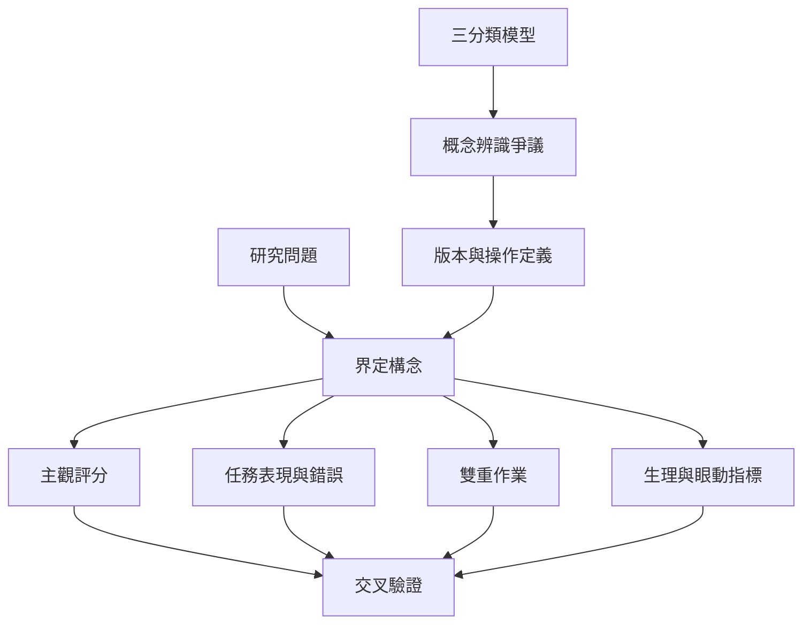

認知負荷不是可直接讀取的單一量值。研究必須界定負荷的操作性定義，並根據任務選擇自陳、表現、雙重作業或生理指標。不同理論版本對負荷分類的處理也必須明確交代。

概念互連：[[term/主觀工作負荷]]、[[term/NASA-TLX]]、[[term/任務切換]]、[[term/認知負荷]]、[[term/增生負荷]]。

核心筆記：[[note/認知負荷測量應採取任務適配的多指標策略]]、[[note/認知負荷三分類的邊界並非毫無爭議]]、[[note/不是所有高認知負荷都會降低學習]]。
