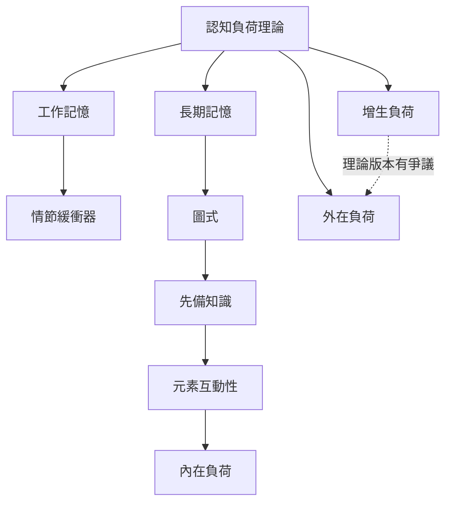

認知負荷理論的核心是：工作記憶處理新資訊的容量有限，長期記憶中的圖式則能重新組織資訊。理解負荷必須同時考量任務元素關係與學習者先備知識。

概念互連：[[term/認知負荷]]、[[term/認知負荷理論]]、[[term/工作記憶]]、[[term/長期記憶]]、[[term/圖式]]、[[term/元素互動性]]、[[term/內在負荷]]、[[term/外在負荷]]、[[term/增生負荷]]、[[term/情節緩衝器]]。

核心筆記：[[note/認知負荷不是資訊數量而是當下必須同時整合的元素關係]]、[[note/先備知識會使同一份教學支援對不同人產生相反效果]]、[[note/認知負荷三分類的邊界並非毫無爭議]]。
