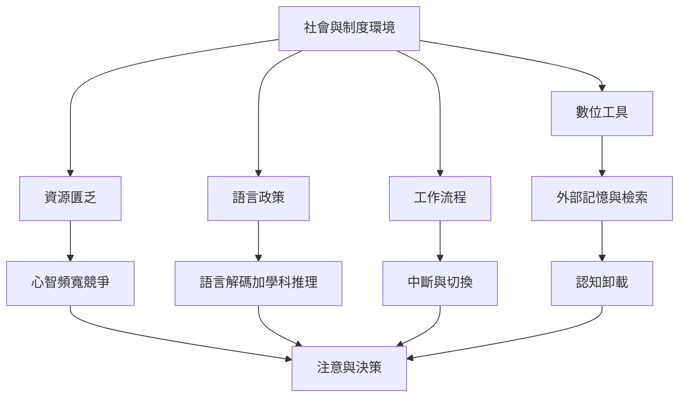

心智資源並非只受教材設計影響。經濟匱乏、多語授課、行政流程、工作中斷與數位工具，都可能改變人們可用的注意力與規劃空間。將這些情境納入討論，有助於避免把制度製造的成本歸咎於個人。

概念互連：[[term/心智頻寬]]、[[term/語言負荷]]、[[term/任務切換]]、[[term/認知卸載]]、[[term/交易式記憶]]、[[term/認知負荷]]。

核心筆記：[[note/持續匱乏會把注意力拉向眼前問題並壓縮規劃空間]]、[[note/第二語言授課可能把語言解碼與學科推理疊加]]、[[note/語言學習的認知負荷與焦慮應一併評估但不可直接推論因果]]、[[note/數位中斷的成本來自重新建構任務脈絡]]、[[note/照顧制度與公共服務也應被視為認知環境設計]]。
