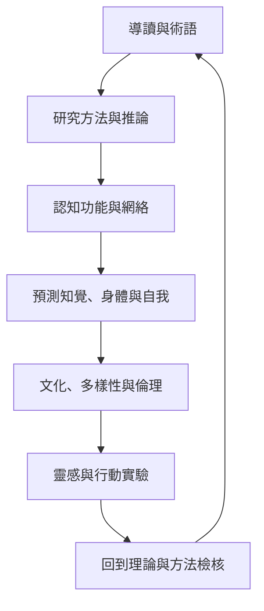

這張地圖把全書的閱讀順序整理為：先掌握概念與研究方法，再進入認知功能，接著比較理論框架，最後以文化、倫理與實作反思收束。

概念地圖：[[認知神經科學的研究方法地圖]]、[[認知功能與神經網絡地圖]]、[[預測知覺、身體與自我地圖]]、[[文化、多樣性與神經科學倫理地圖]]、[[第一人稱經驗與社會認知地圖]]。

全部永久筆記從此進入：[[認知功能由跨腦區網絡與時間動態共同實現]]、[[腦區活化不等於心理功能的專屬定位]]、[[研究方法必須由問題而不是儀器名稱決定]]、[[神經測量提供不同時間與空間尺度的證據]]、[[因果主張需要超越腦活動相關性的證據]]、[[心理構念必須先被清楚操作化才能測量]]、[[注意力是在競爭訊息間配置處理優先權]]、[[執行控制是在競爭目標間調節行為]]、[[工作記憶是受目標調節的暫時性表徵]]、[[記憶是重建過去而非播放固定紀錄]]、[[海馬迴與皮質協作形成可提取的情節記憶]]、[[預測處理把知覺理解為模型與感覺訊號的持續校正]]、[[預測誤差必須依計算脈絡解讀]]、[[內感受把身體內部訊號帶入認知與情緒調節]]、[[身體與環境共同構成認知活動的條件]]、[[自我經驗是身體訊號、記憶與敘事的動態整合]]、[[文化不是人口背景變項而是認知形成的環境]]、[[跨文化比較必須檢查測量等值性]]、[[研究參與者的多樣性會改變理論的外推範圍]]、[[研究倫理也包括資料與研究資源的治理權]]、[[科學普遍性需要公平的知識生產條件]]、[[第一人稱經驗可以成為可檢驗的研究資料]]、[[語言經驗會形塑認知控制的神經需求]]、[[社會認知需要區分觀點推論與情緒共感]]、[[靜息態活動仍包含有組織的認知歷程]]、[[神經科學的可信度取決於透明、可靠與可重複的流程]]、[[神經影像個體差異研究需要大樣本與可靠測量]]、[[計算模型讓認知理論承擔可檢驗的風險]]。
