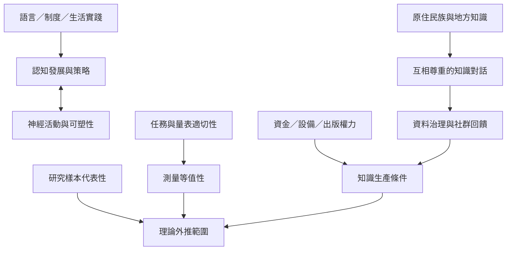

認知研究的「普遍性」必須同時考慮文化脈絡、研究樣本、任務等值性與知識生產條件。全球化不只是把不同地方納入樣本，更包括共同設定問題、分享治理權與資源。

核心筆記：[[文化不是人口背景變項而是認知形成的環境]]、[[跨文化比較必須檢查測量等值性]]、[[研究參與者的多樣性會改變理論的外推範圍]]、[[研究倫理也包括資料與研究資源的治理權]]、[[科學普遍性需要公平的知識生產條件]]。

概念：[[文化神經科學]]、[[跨文化研究]]、[[心理構念]]、[[可重複性]]。

實作：[[設計一份跨文化認知研究的共同參與流程]]、[[把神經科學的全球化理解為共同定義問題而不只是輸出技術]]。

延伸概念：[[研究倫理]]、[[心理測量]]、[[跨文化研究]]。
