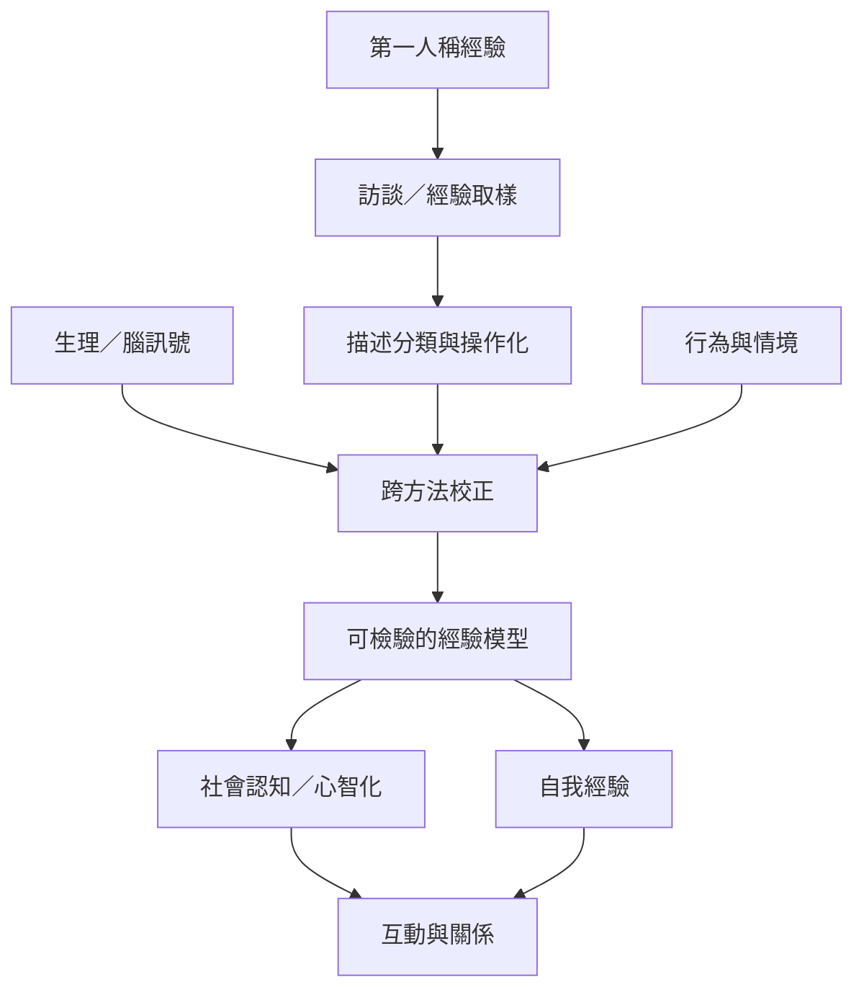

本圖整理主觀經驗、心智化、情緒共感與研究方法之間的關係。第一人稱描述可成為資料，但必須透過中性訪談、經驗取樣、清楚操作化與跨方法校正，避免將推測當成透明的內在事實。

核心筆記：[[第一人稱經驗可以成為可檢驗的研究資料]]、[[社會認知需要區分觀點推論與情緒共感]]、[[自我經驗是身體訊號、記憶與敘事的動態整合]]、[[心理構念必須先被清楚操作化才能測量]]。

概念：[[神經現象學]]、[[心智理論]]、[[意識]]、[[自我經驗]]、[[內感受]]。

實作：[[用第一人稱經驗與生理測量的差異設計一個方法課]]、[[用記憶訪談比較事件、回憶與後來形成的敘事]]。

延伸概念：[[第一人稱方法]]、[[社會認知]]、[[情緒共感]]。
