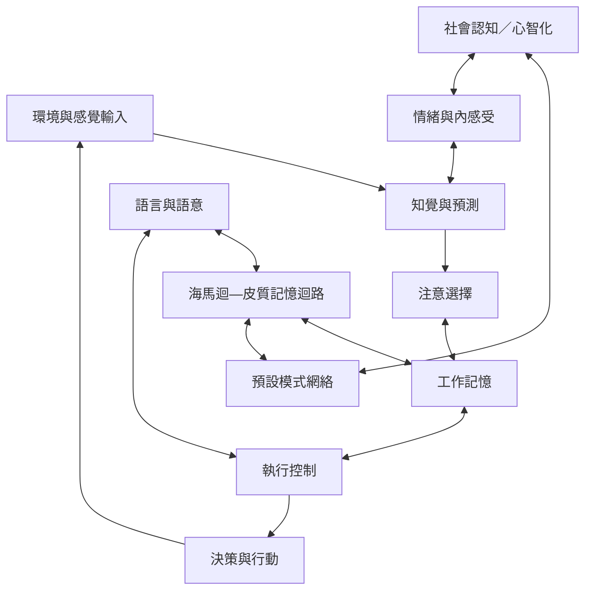

本圖將知覺、注意、記憶、語言、執行控制與社會認知放在互相交織的網絡中。各認知領域有相對常見的神經迴路，但不是互斥的模組；同一腦網絡可參與多種任務，同一任務也會招募多個系統。

核心筆記：[[認知功能由跨腦區網絡與時間動態共同實現]]、[[注意力是在競爭訊息間配置處理優先權]]、[[工作記憶是受目標調節的暫時性表徵]]、[[記憶是重建過去而非播放固定紀錄]]、[[執行控制是在競爭目標間調節行為]]、[[社會認知需要區分觀點推論與情緒共感]]。

概念：[[認知]]、[[注意力]]、[[執行功能]]、[[工作記憶]]、[[情節記憶]]、[[海馬迴]]、[[預設模式網絡]]、[[心智理論]]。

實作：[[把注意力研究轉化成一場小型共學實驗]]、[[用記憶訪談比較事件、回憶與後來形成的敘事]]。

延伸概念：[[記憶]]、[[學習]]、[[認知控制]]、[[社會認知]]、[[情緒]]。
