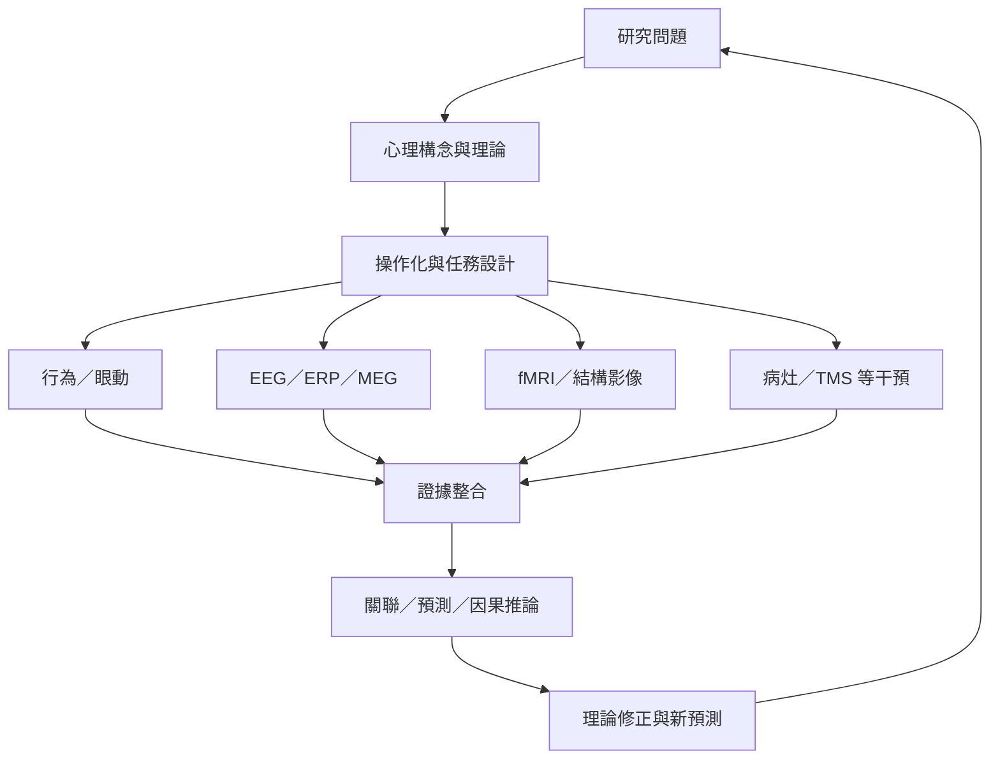

本圖以研究問題為核心，連接心理構念、操作化、神經測量與推論層次。閱讀重點不是背誦儀器，而是理解每種資料能回答什麼、不能回答什麼，以及何時需要互補方法。

核心筆記：[[研究方法必須由問題而不是儀器名稱決定]]、[[神經測量提供不同時間與空間尺度的證據]]、[[因果主張需要超越腦活動相關性的證據]]、[[心理構念必須先被清楚操作化才能測量]]、[[腦區活化不等於心理功能的專屬定位]]。

概念：[[認知神經科學]]、[[神經影像]]、[[功能性磁振造影]]、[[腦電圖]]、[[事件相關電位]]、[[經顱磁刺激]]、[[反向推論]]、[[心理構念]]、[[計算模型]]、[[可重複性]]。

實作：[[建立一份閱讀論文的五層推論檢核表]]、[[用第一人稱經驗與生理測量的差異設計一個方法課]]。

## 閱讀提示
先選一篇文獻，用圖中的箭頭逐步填入實際內容。若無法說清楚構念如何變成測量指標，就先不要接受後面的腦區解釋。

延伸概念：[[因果推論]]、[[心理測量]]、[[學習]]。
