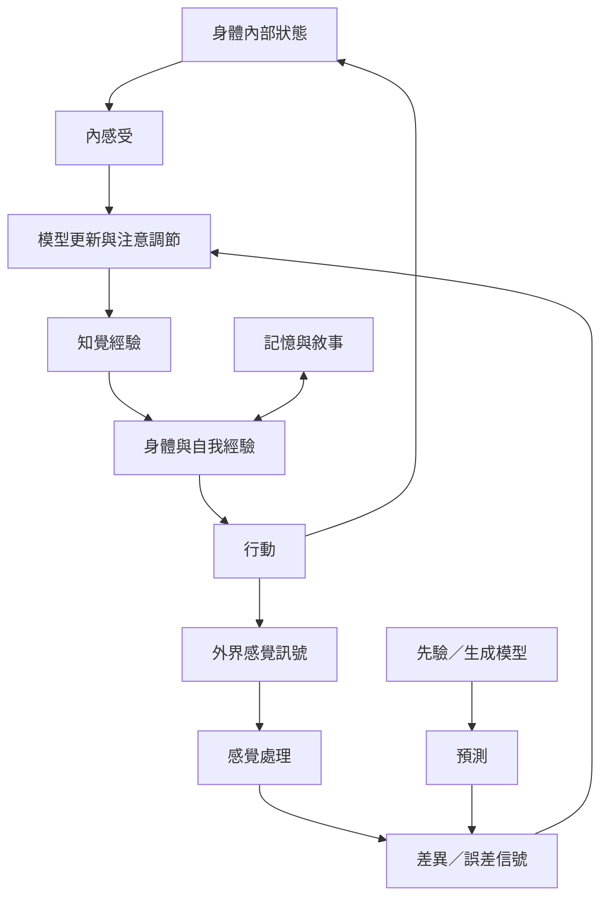

此圖將預測處理、內感受、身體行動與自我經驗連起來。預測處理是一組理論框架，不宜視為已經解決所有知覺問題的統一答案；內感受與第一人稱經驗則提供理解身體自我的重要入口。

核心筆記：[[預測處理把知覺理解為模型與感覺訊號的持續校正]]、[[預測誤差必須依計算脈絡解讀]]、[[內感受把身體內部訊號帶入認知與情緒調節]]、[[自我經驗是身體訊號、記憶與敘事的動態整合]]、[[身體與環境共同構成認知活動的條件]]。

概念：[[預測處理]]、[[預測誤差]]、[[內感受]]、[[具身認知]]、[[意識]]、[[自我經驗]]。

實作：[[用一段步行紀錄練習區分感覺訊號與對感覺的解讀]]、[[替預測處理理論製作一張可反駁預測卡]]。

## 閱讀提示
先閱讀 2026 年對預測處理的批判性回顧，再讀 2024 年跨認知領域的統合分析。兩者合讀能避免把理論口號當作已經確立的機制。

延伸概念：[[貝葉斯推論]]、[[情緒]]、[[可供性]]。
