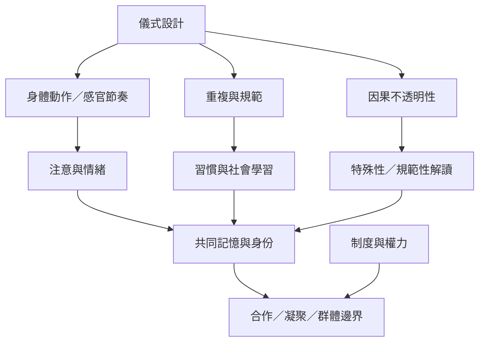

儀式同時是一種身體行動、注意安排、社會規範與群體記憶。它可能提供控制感或社會支持，也可能產生排除、壓力與權力不平等。

## 概念關聯
[[儀式]]、[[宗教模式理論]]、[[因果不透明性]]、[[儀式立場]]、[[身份融合]]、[[親社會行為]]、[[群體邊界]]、[[強化學習]]。

可從 [[頻繁儀式和高情緒儀式適配不同群體規模]] 與 [[宗教合作效應可能同時帶來內群體凝聚與外群體界線]] 展開。
